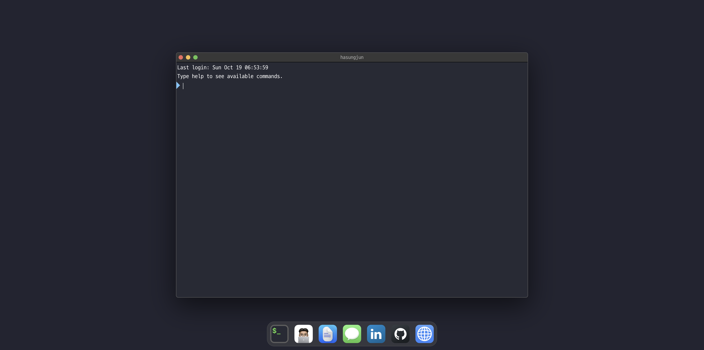

# 전하성 - 포트폴리오 웹사이트

> 제 프로젝트, 기술 스택, 경력을 보여주는 현대적이고 반응형인 포트폴리오 웹사이트입니다.

**Language:** [English](./README.md) | 한국어

---

🔗 **라이브 데모:** [hasungjun.com](https://hasungjun.com)



<!-- 스크린샷을 추가하세요 -->

## ✨ 주요 기능

- 📱 완전한 반응형 디자인
- 🌏 다국어 지원 (i18n) - 영어 & 한국어
- 🎨 부드러운 애니메이션과 현대적인 UI/UX
- ⚡ Next.js 최적화로 빠른 페이지 로딩
- 📧 연락처 폼 통합
- 🔍 SEO 최적화

## 🛠 기술 스택

- **프레임워크:** [Next.js 16](https://nextjs.org/)
- **스타일링:** [Tailwind CSS](https://tailwindcss.com/)
- **언어:** TypeScript
- **애니메이션:** Framer Motion
- **다국어:** next-intl
- **아키텍처:** Feature-Sliced Design (FSD)
- **배포:** [Vercel](https://vercel.com/)

## 🚀 시작하기

### 사전 요구사항

- Node.js 22+
- pnpm

### 설치 방법

```bash
# 저장소 클론
git clone https://github.com/iianjun/hasungjun.com.git

# 프로젝트 디렉토리로 이동
cd hasungjun.com

# 의존성 설치
pnpm install

# 개발 서버 실행
pnpm --filter v1 dev
```

브라우저에서 [http://localhost:3000](http://localhost:3000)을 열어 확인하세요.

## v2 데스크톱 기반

`apps/v2`에 React + Vite 데스크톱 구현을 추가했음. 기존 Next.js 사이트는 `apps/v1`에 있음.

```bash
pnpm install --frozen-lockfile
pnpm dev:v2
```

[http://127.0.0.1:5173](http://127.0.0.1:5173)에서 확인할 수 있음. 데스크톱 viewport는 최소 1024 × 640임.
Notes와 Shapes에서 여러 창의 열기·포커스·이동·크기 조절·최소화·복원·닫기·앱 종료를 확인할 수 있음.
Window 메뉴에서 키보드 이동과 크기 조절을 시작할 수 있음.
방향키는 10px, Shift + 방향키는 1px 단위임. Enter로 확정함. Escape 또는 Tab으로 취소함.

각 앱이 작업 데이터를 소유함. 셸이 창 좌표와 앱 실행 수명을 소유함.
지원하지 않는 viewport로 전환해도 현재 방문의 데이터를 메모리에 보존함. 새로고침하면 초기화함.
운영 화면에는 테마 전환이 없음. contrast 토큰은 테마 경계로 유지함.
모바일 UI·다크 최종 디자인·홈페이지 콘텐츠·운영 전환은 후속 범위임.

```bash
pnpm check:v2
pnpm build:v2
# WebKit 보조 엔진 설치. 브라우저 검증에는 로컬 Google Chrome도 필요함.
pnpm --filter v2 exec playwright install webkit
pnpm test:v2:browser
```

브라우저 검증은 1512 × 945 CSS pixels, DPR 2를 사용함. 실제 macOS와 비교하는 기준 조건과 같음.
고정 화면과 JSON 결과를 `apps/v2/test-results`에 생성함.
WebKit 자동 검증과 실제 Safari 확인을 구분함.
macOS 외형은 알려진 차이가 있는 첫 구현임. 시각적 완료 판정은 아직 열려 있음.

## 📁 프로젝트 구조

v1은 [Feature-Sliced Design](https://feature-sliced.design/) 아키텍처를 따름. 아래 경로는 `apps/v1` 기준임:

```
hasungjun.com/
├── app/              # Next.js 앱 디렉토리 (라우팅)
├── src/
│   ├── app/          # Application 레이어 (providers, styles)
│   ├── pages/        # Pages 레이어 (페이지 구성)
│   ├── widgets/      # Widgets 레이어 (header, footer 등)
│   ├── features/     # Features 레이어 (사용자 인터랙션)
│   ├── entities/     # Entities 레이어 (비즈니스 엔티티)
│   ├── shared/       # Shared 레이어 (UI kit, utils, config)
├── public/           # 정적 파일
└── messages/         # i18n 번역 파일
```

## 🌐 배포

이 프로젝트는 Vercel에 자동으로 배포됩니다. `main` 브랜치에 푸시하면 새로운 배포가 트리거됩니다.

## 📫 연락처

- **웹사이트:** [hasungjun.com](https://hasungjun.com)
- **GitHub:** [@iianjun](https://github.com/iianjun)
- **LinkedIn:** [전하성](https://github.com/iianjun)
- **이메일:** hasungjunn@gmail.com

## 📄 라이선스

이 프로젝트는 오픈소스이며 [MIT License](LICENSE) 하에 제공됩니다.

---

⭐ 이 프로젝트가 마음에 드신다면 GitHub에서 스타를 눌러주세요!
