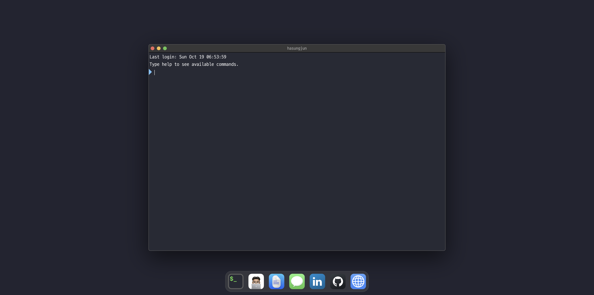

# Hasung Jun - Portfolio Website

> A modern, responsive portfolio website showcasing my projects, skills, and experience.

**Language:** English | [한국어](./README.ko.md)

---

🔗 **Live Demo:** [hasungjun.com](https://hasungjun.com)



<!-- Add your screenshot here -->

## ✨ Features

- 📱 Fully responsive design
- 🌏 Internationalization (i18n) - English & Korean support
- 🎨 Modern UI/UX with smooth animations
- ⚡ Fast page loads with Next.js optimization
- 📧 Contact form integration
- 🔍 SEO optimized

## 🛠 Built With

- **Framework:** [Next.js 16](https://nextjs.org/)
- **Styling:** [Tailwind CSS](https://tailwindcss.com/)
- **Language:** TypeScript
- **Animations:** Framer Motion
- **i18n:** next-intl
- **Architecture:** Feature-Sliced Design (FSD)
- **Deployment:** [Vercel](https://vercel.com/)

## 🚀 Getting Started

### Prerequisites

- Node.js 22+
- pnpm

### Installation

```bash
# Clone the repository
git clone https://github.com/iianjun/hasungjun.com.git

# Navigate to the project directory
cd hasungjun.com

# Install dependencies
pnpm install

# Run the development server
pnpm --filter v1 dev
```

Open [http://localhost:3000](http://localhost:3000) to view it in your browser.

## v2 desktop foundation

`apps/v2` contains the React + Vite desktop implementation. The existing Next.js site stays in `apps/v1`.

```bash
pnpm install --frozen-lockfile
pnpm dev:v2
```

Open [http://127.0.0.1:5173](http://127.0.0.1:5173). Use a desktop viewport of at least 1024 × 640.
Notes and Shapes exercise multiple windows, focus, dragging, resizing, minimizing, restoring, closing, and quitting.
The Window menu exposes keyboard move/resize: arrows move 10 px, Shift + arrows move 1 px, Enter confirms, and Escape or Tab cancels.

Each app owns its data. The shell owns window geometry and application lifetimes. Data stays in memory during this page visit, including temporary transitions to an unsupported viewport. Refreshing resets the session.
The View menu offers a contrast preview to exercise the theme boundary. Mobile UI, final dark styling, portfolio content, and deployment are later work.

```bash
pnpm check:v2
pnpm build:v2
# Install the supplemental WebKit engine; browser tests also require local Google Chrome.
pnpm --filter v2 exec playwright install webkit
pnpm test:v2:browser
```

Browser tests use 1440 × 900 CSS pixels at DPR 2. They record fixed screenshots and JSON results in `apps/v2/test-results`.
WebKit automation supplements actual Safari checks; it does not replace Safari.
The macOS appearance is an initial implementation with known visual differences. Visual acceptance remains open.

## 📁 Project Structure

The v1 app follows [Feature-Sliced Design](https://feature-sliced.design/). The paths below are relative to `apps/v1`:

```
hasungjun.com/
├── app/              # Next.js app directory (routing)
├── src/
│   ├── app/          # Application layer (providers, styles)
│   ├── pages/        # Pages layer (page compositions)
│   ├── widgets/      # Widgets layer (header, footer, etc.)
│   ├── features/     # Features layer (user interactions)
│   ├── entities/     # Entities layer (business entities)
│   ├── shared/       # Shared layer (UI kit, utils, config)
├── public/           # Static assets
└── messages/         # i18n translation files
```

## 🌐 Deployment

This project is automatically deployed to Vercel. Any push to the `main` branch triggers a new deployment.

## 📫 Contact

- **Website:** [hasungjun.com](https://hasungjun.com)
- **GitHub:** [@iianjun](https://github.com/iianjun)
- **LinkedIn:** [Hasung Jun](https://github.com/iianjun)
- **Email:** hasungjunn@gmail.com

## 📄 License

This project is open source and available under the [MIT License](LICENSE).

---

⭐ If you like this project, please consider giving it a star on GitHub!
