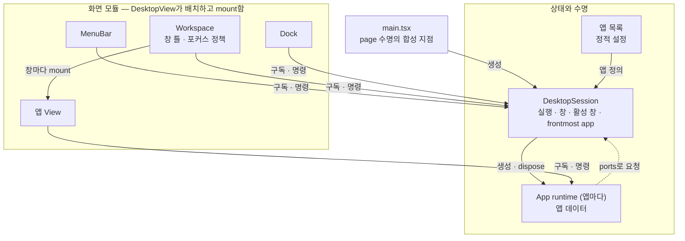

# v2 구조

v2에 앱이나 Shell 모듈을 추가할 때, 또는 상태의 소유자를 정할 때 이 문서를 읽을 것.
이 문서는 macOS 데스크톱 Shell의 모듈 경계를 정함. 외형은 [DESIGN.md](DESIGN.md)가 정함.

이 문서는 목표 구조를 적음. 현재 코드와 다른 부분은 마지막 절에 있음.

## 큰 그림

Shell은 두 층으로 나뉨. 위층은 상태를 소유함. 아래층은 상태를 화면에 표시함.

```text
macOS Shell
│
├─ 상태와 수명
│  ├─ DesktopSession          page 수명
│  │    실행 / 창 / 활성 창 / frontmost app
│  │    앱 종료 시 관련 상태를 한 번에 전이함
│  │    App runtime을 생성하고 dispose함
│  │
│  ├─ App runtime (앱마다)    run 수명
│  │    앱 데이터를 소유함
│  │
│  └─ 앱 목록                 정적 설정
│       설치할 앱과 Dock 순서
│
└─ 화면 모듈 — 각각 붙이거나 뗄 수 있음
   ├─ Workspace   ← DesktopSession
   ├─ Dock        ← DesktopSession + 앱 목록
   └─ MenuBar     ← DesktopSession + 앱 목록
```

`←`는 그 모듈이 읽는 대상임. 화면 모듈은 서로를 읽지 않음.

## 연결



화살표는 의존 방향임. 화면 모듈은 상태 층에 의존함. 상태 층은 화면 모듈을 모름.
앱은 `DesktopSession`을 직접 잡지 않음. 생성 때 받은 ports로만 요청함.

## 경계 원칙

- **실행과 창은 한 owner가 가짐.** `DesktopSession`이 둘을 한 transaction으로 바꿈. 앱 종료는 실행과 창을 함께 지우고 snapshot을 한 번 발행함. 중간 상태는 밖에서 보이지 않음.
- **화면 모듈은 표시(projection)임.** 상태를 구독하고 명령을 보냄. 실행이나 창의 상태를 따로 보관하지 않음. 열린 메뉴 같은 화면 상태만 컴포넌트 안에 둠.
- **실행에 딸린 표시는 실행 목록에서 유도함.** Dock의 실행 표시가 그 예임. 등록과 해제 절차가 없으므로 앱이 종료되면 같은 render에서 사라짐.
- **수명이 다른 상태만 따로 둠.** 따로 둔 상태는 `main.tsx`가 `DesktopSession` 옆에서 생성함. 화면 모듈은 필요한 소유자만 직접 구독함.
- **키보드 포커스는 Workspace만 옮김.** 다른 화면 모듈은 명령만 보냄. Workspace가 Shell 상태의 변화를 보고 활성 창에 포커스를 둠.
- **상태 층은 React를 모름.** `DesktopSession`과 App runtime은 일반 class임. React 연결은 `react` 파일과 View가 담당함.

수명은 세 가지임.

| 수명 | 뜻 | 해당하는 것 |
| ---- | -- | ----------- |
| page | 방문이 끝날 때까지 유지함. 작은 화면 안내로 전환해도 유지함. | `DesktopSession` |
| run | 앱 실행부터 종료까지 유지함. 창이 없어도 실행은 유지할 수 있음. | App runtime |
| mount | 화면에 표시하는 동안만 유지함. | 화면 모듈, 앱 View |

## 상태를 둘 곳

| 상태 | 소유자 |
| ---- | ------ |
| 실행, 창, 활성 창, frontmost app, 창 위치와 크기 | `DesktopSession` |
| 앱 데이터 | 그 앱의 App runtime |
| 설치할 앱, Dock 순서 | 앱 목록 |
| 실행에 딸린 표시 | 소유자 없음. 실행 목록에서 유도함. |
| 열린 메뉴, hover | 컴포넌트 local state |

새 상태는 이 표에서 함께 바뀌는 상태의 소유자에게 둘 것.
맞는 소유자가 없고 수명도 다르면 별도 store를 만들 것.

## 앱 모듈

앱은 폴더 하나임. Shell은 앱 이름을 모름.

| 부분 | 역할 |
| ---- | ---- |
| core class | App runtime임. 앱 데이터와 창별 상태를 소유함. |
| View와 `react` 파일 | App runtime을 구독해서 창 안을 그림. |
| `application.tsx` | 등록 모듈임. 생성 의존성, 아이콘, View 연결을 조합함. |

앱과 Shell은 두 방향의 계약으로 연결함. 계약의 정의는 `desktop/types.ts`와 `desktop/react.tsx`에 있음.

- **앱 → Shell:** 생성 방법, 창 열림·닫힘·정리에 대한 응답, 아이콘, 창 안의 화면을 제공함.
- **Shell → 앱:** ports를 제공함. 앱은 ports로 새 창, 창 닫기, 실패 보고를 요청함.

앱을 추가할 때는 앱 폴더를 만들고 앱 목록에 한 줄을 추가함. Shell 코드는 수정하지 않음.
Shell 모듈이 앱 데이터를 표시해야 하면 그 앱의 App runtime을 구독함. 앱 데이터를 Shell snapshot에 복사하지 않음.

## 도입하지 않은 구조

모듈 연결은 JSX 합성과 직접 구독으로 함. 전제는 모든 앱이 first-party이고 빌드 시 합성한다는 것임.
아래 구조는 오른쪽 조건이 생기면 다시 검토할 것.

| 구조 | 다시 검토할 조건 |
| ---- | ---------------- |
| 실행 store와 창 store의 분리 | 실행과 창이 서로 다른 transaction으로 바뀌어야 할 때 |
| Shell 모듈 registry, DI container, 범용 event bus | 외부 plugin을 런타임에 붙여야 할 때 |
| 범용 메뉴 서비스 | 앱이 다른 앱의 메뉴에 항목을 추가해야 할 때 |

## 현재 코드와의 차이

화면 모듈은 각자 `DesktopSession`을 구독하고, `DesktopView`는 배치만 함. 남은 차이는 2개임.

- 앱 목록을 읽는 경로가 둘임. `DesktopSession`은 생성 때 받고, 화면 모듈은 직접 import함.
- 창이 없으면 Workspace가 Dock의 `data-dock` 표식을 찾아 포커스를 보냄. Dock을 떼면 이때 포커스를 옮기지 않음.
